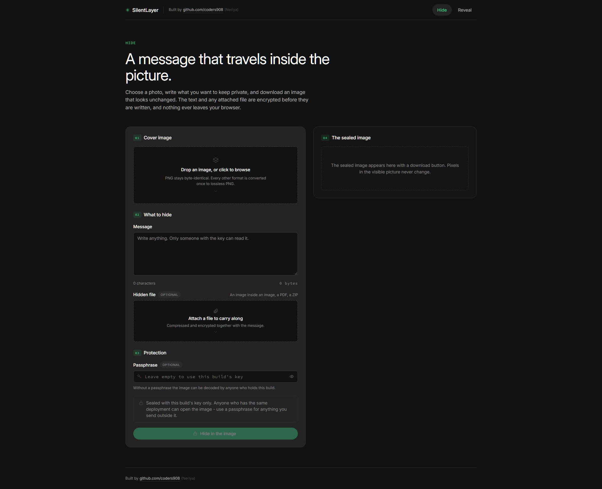

# SilentLayer

[](./LICENSE)
[](./package.json)
[](https://nodejs.org)
[](./tsconfig.json)

<p align="center">
  
</p>

<p align="center">
  <a href="https://silentlayer.dpdns.org"><strong>Try the live demo at silentlayer.dpdns.org</strong></a>
</p>

Hide an encrypted message, and optionally a whole file, inside a photograph. Recover it later from
the image alone. Everything runs in the browser: no upload, no account, no server.

SilentLayer is a static React + TypeScript app. Encrypt a payload, write it into an image, share the
image, and let the recipient drop it back in to read what was inside.

You do not have to install anything to try it. The hosted demo at
[silentlayer.dpdns.org](https://silentlayer.dpdns.org) runs the exact production build: drop an
image, hide a message, download it, then reload the page and reveal it again.

## Why SilentLayer

- **Two independent carriers.** A payload is written twice, into layers that fail under different
  conditions. One survives lossless handling, the other survives JPEG recompression.
- **Real authenticated encryption.** AES-256-GCM with a random salt and IV per image, so the same
  content sealed twice produces two completely different files.
- **Optional passphrase.** Seal with a per-image passphrase using PBKDF2-HMAC-SHA-256, or use the
  build key for a private single-owner deployment.
- **Pixels stay untouched** in the appended layer. The visible picture is byte-for-byte identical.
- **Error correction that earns its keep.** Reed-Solomon over interleaved blocks, repeated length
  prefixes, and 48-fold bit repetition with soft voting in the frequency layer.
- **Off the main thread.** All DCT work runs in a Web Worker with live progress, so large photos do
  not freeze the tab.
- **Drop in, drop out.** Both screens are single-purpose. No configuration, no wizard, no signup.

## How it works

1. **Package.** The message and optional attachment are serialised into one binary blob, then
   gzipped. Compression happens before encryption, because ciphertext cannot be compressed.
2. **Encrypt.** The blob is sealed with AES-256-GCM. The envelope stores a format version, the key
   mode, a 16-byte salt, and a 12-byte IV.
3. **Write twice.**
   - *Appended layer:* the envelope is appended after the PNG `IEND` chunk with a length trailer.
     Zero pixel change, capacity limited only by browser memory.
   - *Frequency layer:* the envelope is error-correction encoded, then modulated into mid-frequency
     DCT coefficients of 8x8 luminance blocks. This is the layer that survives recompression.
4. **Reveal.** The appended layer is tried first because it is fast and exact. If it is missing or
   damaged, the frequency layer is read and decoded through Reed-Solomon.

## Getting started

### Requirements

- Node.js 20 LTS or newer. Vite 6 supports 18, 20, and 22+, and skips odd-numbered releases, so
  prefer an even-numbered LTS.
- npm 9 or newer (pnpm and yarn work too).

### Install

```bash
git clone https://github.com/coders908/SilentLayer.git
cd SilentLayer
npm install
```

### Configure

Create a local environment file from the template:

```bash
cp .env.example .env
```

Then set a random workspace key in `.env`:

```bash
node -e "console.log(require('node:crypto').randomBytes(32).toString('base64url'))"
```

```dotenv
VITE_SILENTLAYER_WORKSPACE_KEY=your-generated-value-here
```

The workspace key is inlined into the shipped bundle, so it keeps casual visitors out but is not a
secret from anyone who can load the site. Use the passphrase field in the UI for images that leave
your own deployment.

### Run

```bash
npm run dev
```

Open the printed URL, usually `http://localhost:9878`.

### Build

```bash
npm run build
npm run start
```

The production output goes to `dist/`.

## Usage

### Hide a message

1. Go to **Hide** (`/`).
2. Drop a cover image. PNG is used as is; other formats are converted once to lossless PNG.
3. Type a message and optionally attach a file.
4. Optionally enter a passphrase, or leave it empty to use the build key.
5. Press **Hide in the image** and download the result.

### Reveal a message

1. Go to **Reveal** (`/decode`).
2. Drop the sealed image.
3. Enter the passphrase if the sender used one, otherwise leave it empty.
4. Press **Extract the content**. The message and any file appear on the right.

### Quick programmatic use

The crypto and framing layer is plain TypeScript with no React dependency:

```ts
import { sealEnvelope, openEnvelope } from './src/lib/envelope';

const plaintext = new TextEncoder().encode('meet me at the pier');
const envelope = await sealEnvelope(plaintext, { passphrase: 'correct horse battery' });
const recovered = await openEnvelope(envelope, { passphrase: 'correct horse battery' });

console.log(new TextDecoder().decode(recovered));
```

## Capacity

The appended layer is effectively unbounded. The frequency layer is not, so check these numbers
before promising that a payload will survive recompression:

| Image size | Frequency layer payload |
| --- | --- |
| 1920 x 1080 (2.1 MP) | ~638 bytes |
| 3000 x 2000 (6 MP) | ~1.9 KB |
| 4000 x 3000 (12 MP) | ~3.8 KB |

These figures are net of the 50 percent error-correction overhead. The UI reports the real number
for the image you load, and falls back to the appended layer only when a payload does not fit.

## Security model

**Protected against**

- Anyone viewing or receiving the image in a normal viewer or chat app.
- Anyone who has the image but not the key.
- Tampering: the GCM authentication tag rejects modified ciphertext.

**Not protected against**

- **File-level forensic analysis.** The appended payload is a detectable byte region. `binwalk`,
  `strings`, or a size comparison against the original reveals that something was added. This is
  concealment from viewers, not deniability.
- **Holding the build key.** If someone has both the image and this deployment's bundle, and the
  image was sealed without a passphrase, they can decrypt it.
- **Losing the passphrase.** There is no recovery path and no escrow.

## Limitations

- Output is always PNG. Converting to JPEG, or uploading to a service that recompresses images,
  destroys the appended layer.
- The frequency layer only helps when the payload fits within its capacity.
- Animated images (GIF, APNG) are rejected, because only one frame can be carried.
- There is no key rotation. Changing the workspace key makes images sealed with it unreadable.

## Project structure

```text
src/
  lib/
    envelope.ts          AES-256-GCM sealing, versioned header, key modes
    keyvault.ts          HKDF for the workspace key, PBKDF2 for passphrases
    secret-payload.ts    message and attachment binary format, gzip
    ecc-framing.ts       length prefixes, block framing, interleaving
    reed-solomon.ts      GF(256) encoder and decoder
    spectral-kernel.ts   DCT carrier, DOM-free so it can run in a worker
    spectral-client.ts   promise wrapper around the worker
    carrier.ts           orchestrates both layers for embed and extract
    image.ts             file loading, canvas, PNG encoding
    image-plane.ts       ImageData to luminance plane bridge
  workers/
    spectral.worker.ts   off-main-thread DCT runner
  components/            UI primitives (drop zone, action button, icons)
  pages/                 EncodePage and DecodePage
```

## Available scripts

| Command | Description |
| --- | --- |
| `npm run dev` | Start the Vite dev server |
| `npm run build` | Type-check with `tsc` and build to `dist/` |
| `npm run start` | Serve the built output locally |

## Support

- **Bugs and feature requests:** open an issue at
  [github.com/coders908/SilentLayer/issues](https://github.com/coders908/SilentLayer/issues).
- **Questions:** start a discussion in the same repository.
- **Security reports:** please open a private issue or contact the maintainer directly rather than
  filing a public bug.

When reporting a bug, include the browser and version, the image dimensions, whether a passphrase
was used, and the exact error text shown in the UI.

## License

Released under the MIT License. See [LICENSE](./LICENSE) for the full text.

---

Built with ❤️ by **[@Neriya](https://github.com/coders908)**
